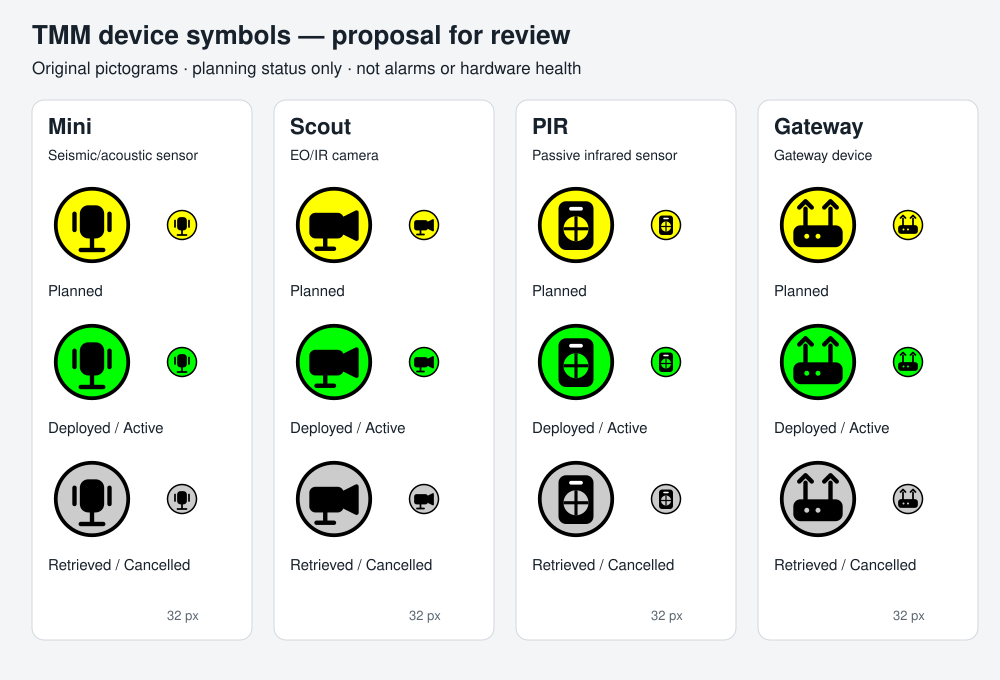

# Device symbol proposal (#43)

Status: **artwork awaiting owner review**. The runtime still uses its provisional
letter icons until the proposed pictograms are approved.

| Device | Proposed original pictogram | Mapping |
|---|---|---|
| Mini | Upright seismic/acoustic pickup | Owner-confirmed association recorded in #43 |
| Scout | Camera body and lens | EO/IR camera |
| PIR | Sensor housing and segmented lens | Passive infrared sensor |
| Gateway | Gateway housing with two antennas | Gateway device, independent of base/mobile roles |

These are independently drawn SVG shapes, not traced or extracted manual images.
The private manual was consulted for device meaning only. No permission to
redistribute its artwork is inferred. Gateway roles, sensor alarms, radio links and
hardware health are not represented by these planning symbols.

The owner approved the following palette in the project conversation on 2026-10-18:

| Planning status | Tint |
|---|---|
| Planned | Yellow (`#FFFF00`) |
| Deployed / Active | Green (`#00FF00`) |
| Retrieved / Cancelled | Gray (`#CCCCCC`) |

No red/fault state is introduced. Status remains manually maintained and explicitly
readable in labels/details. The preview contains enlarged and 32 px samples. Small
pictogram recognition, map-background contrast, actual SDK rendering at relevant
scales and PIR/Scout bearing cues still require verification after artwork approval;
physical screen/accessibility checks remain under #12.

No domain, snapshot or wire change is proposed. Source masters are the four SVGs
in `docs/assets/device-symbols/`. White areas receive the SDK planning tint; black
outlines/pictograms provide contrast and shape identification independently of hue.
